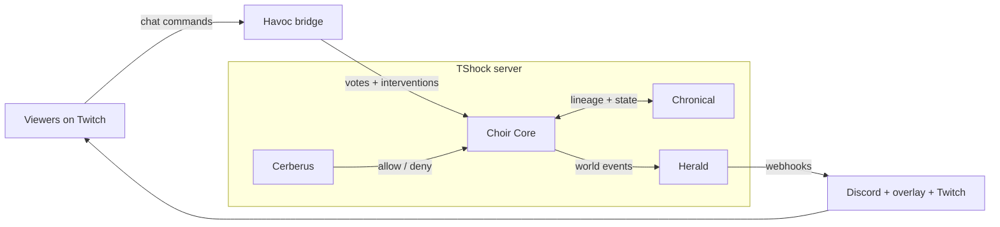

# Choir — Terraria Server Suite & Bot Platform

*Plan parked October 2026. Feeds the Phase 4 gate; nothing here is scheduled work yet.
Named for the angelic choirs — heaven's own taxonomy: every block is a voice, the event bus is the score. (Working name "Choir", retired Oct 2026; rename logged in the master plan review log.)*

## 1. Thesis

One deterministic bot core; every game mode is a configuration on top of it; every server extension
is a small building block the modes reuse. **No LLM in the runtime.** Old-school AI in the UT-bot /
Sims tradition: utility scoring, behavior trees, finite state machines. Zero marginal cost,
Pi-friendly, no live-generation moderation risk, and honest content — when a character dies,
viewers know the rules did it, not a prompt. An optional LLM narration package (Herald Voice) is a
later, opt-in premium tier — local model, hard-capped — keeping master-plan rule 1 intact.

## 2. The building blocks

| Block | Repo | One responsibility | Provides to the others |
|---|---|---|---|
| Cerberus (Gate) | TShock-Cerberus | Access, anti-grief, zone protection | Protected arenas, visitor sandboxes |
| Herald (Voice) | TShock_Herald | Events → broadcasts & webhooks | Narration hooks for everything |
| Havoc (Bridge) | TShock_Havoc | Twitch chat → server commands | Viewer agency: votes, sponsors, interventions |
| Chronical (Memory) | TShock_Chronical | Persistent world & lineage state | Family trees, leaderboards, chronicle overlay data |
| Metatron (Scribe) | TShock_Metatron | Shared plumbing (re-scoped; see SUITE_AUDIT.md) | Event bus, cross-plugin messaging |
| **Choir Core** | NEW repo (Phase 4) | Bot engine: perceive → score → act | Characters for every mode |
| Stream Doctor / FrictionPoint | external | Stream & server reliability | Uptime for the 24/7 show |

Rules that keep blocks small:

- One responsibility per plugin. A second responsibility means a new block, not a bigger one.
- Modes are configs (personality packs, goal tables, faction definitions) — never engine forks.
- Plugins talk through Metatron's event bus, never each other's internals.
- Every block: config-driven, headless-testable, CI-green, pinned to a TShock release.
- Maintenance budget ≤ 2 hrs/week per block (master-plan rule 5). A block that busts the budget
  gets cut, not the sleep.

## 3. How it flows

The loop: viewers steer → bots act under their own dumb-heroic logic → the world changes → Herald
narrates the change → Chronical records it → Cerberus guards every step. The loop *is* the show.

## 4. Mode ladder (ship order)

| # | Mode | What it is | Reuses | License (founding) |
|---|---|---|---|---|
| 1 | **Backfill bots** | "Never play alone" — visible, labeled AI companions for any server | Core only | $9 |
| 2 | **Idle Terraria** | Persistent always-on world progress; the 24/7 ambient show | Core + Chronical | $15 |
| 3 | **Dynasty** | Roguelite generations, community-directed, permadeath; the flagship event show | Core + Chronical + Herald + Havoc | $25 |
| 4 | **Faction Wars** (mode) | Faction wars; viewers sponsor armies via Havoc; the spectacle finale | All blocks | $25 |

Suite bundle: everything for $49 founding (visible on day one, per the master-plan pricing rule).

Backfill bots is the wedge: smallest scope, obvious value, and it debugs the core in the wild on
other people's servers. **Framing rule: honest, labeled AI companions — never fake player counts.**
The fake-players corner of Minecraft plugin culture is the one reputation trap in this niche.

Each mode is content for the channel; the channel is the demo for every mode. Nothing is wasted:
Idle Terraria and Dynasty share ~90% of their systems (goals, persistence, generational progress) —
build once, get both.

## 5. Validated gap (checked Oct 2026)

- NPCBots (TShock AI bot server mod) exists only as a WIP forum thread — unfindable, effectively
  undownloadable.
- Terraria players are publicly asking for exactly this: "fake players with custom AI, vanity,
  weapons… could be the gateway to new vanilla bosses" — and asking why nobody has built it.
- The official Pryaxis plugin list has nothing comparable.

First properly shipped, documented, supported bot plugin owns the niche. The distribution lesson
from that same Reddit thread ("why are TShock plugins so difficult to find"): do not rely on
ecosystem discovery — own the channel and the storefront.

## 6. Support & revenue model

### Product sales — rule 2 (one-time licenses), unchanged
Mode licenses per the table above, sold through historylabs.dev/shop.

### Support contracts — the second sanctioned rule-2 exception
*Rationale: support is metered labor; labor is a real per-user ongoing cost. Same logic as
Stream-Doctor's Live-Data tier.*

- **Free** — community Discord, public issue tracker, best-effort. The core job is never gated
  (master-plan rule 4: free tiers are marketing, not crippleware).
- **Operator contract — $8/mo per server owner**: priority bug resolution (72-hour target), named
  contact channel, priority inclusion of new features and releases.

### Sponsored features & early-access gating
A community member or client can fund a feature. Sponsors receive it during an early-access
window (default: 60 days) before it ships to all licensees. Guardrails:

1. No permanent paywalls — everything ships to everyone eventually.
2. Sponsors accelerate the roadmap; they never steer it off-mission.
3. The window length is public and fixed per feature.

### The show
Twitch subs/bits/ads fund the community server and its hosting — content revenue, not AI billing.
Stream Doctor keeps the stream healthy; FrictionPoint watches the server; the show markets the
entire suite 24/7.

## 7. Finance model & outcome

| Revenue stream | Conservative (year 1) | Done well (years 1–2) |
|---|---|---|
| Mode licenses ($9 / $15 / $25 / $49 bundle) | $1,500 | $9,000 |
| Support contracts ($8/mo) | $500 (≈5 contracts) | $2,400 (≈25 contracts) |
| Twitch (default 50/50 split; 60/40 at 100 Plus Points) | $600 | $3,600 |
| **Total** | **≈ $2,600/yr** | **≈ $15,000/yr** |

Compare: the old Phase 4 estimate was $300–1,500/yr from ~15 server licenses. The bot platform
changes the addressable market from "TShock admins" to "every server that has ever been empty at
3am, plus content creators who want their own dynasty show" — roughly 10–30x the audience at the
same maintenance budget, because modes are configs, not products.

Assumptions: active Terraria server population in the low thousands; conversion logic mirrors the
MediaMaid-undercuts-FileBot play (underprice the incumbent, win on trust); founding prices rise
post-launch. Cost side: infrastructure ≈ $0 (Pi/homelab + static storefront), merchant-of-record
fees ~5% + 50¢, and the real cost — Carl's time — is capped by the small-block rules above.

## 8. Stability & maintenance honesty

The Oct 2026 suite audit flagged TShock API breakage as a risk. Re-framed after review: late-life
Terraria is a **stable core with versioned earthquakes**. TShock 6.x runs on modern .NET 9 and is
actively maintained (6.1.0 stable, March 2026); Terraria 1.4.5.x is a balance-fix phase; major
breakage happens roughly annually and is documented in release notes. That is the right risk
profile for building blocks: after an earthquake you rebuild blocks, not the city. Mitigations:
pin releases, test against TShock release candidates, keep the event-bus contract stable, and
budget one post-earthquake rebuild week per major version.

## 9. Sequence & gates

- Phase 4 (Aug–Oct 2027) unchanged: suite gate at ≥ 15 server licenses. The gate is the floor,
  not the ceiling — this plan is the ceiling.
- De-risk spikes (cheap, inside existing phases): (a) a weekend Choir Core spike — one bot,
  one goal, on a Pi, with a local model nowhere in sight; (b) run the community server unstreamed
  to shake out Cerberus/Havoc in production.
- Chronical's build decision moves from "archive at the Phase 3 gate" to "build if Choir is
  green" — it is the memory of every mode and finally has its purpose.

## 10. Open questions for Carl

1. Support contract price point and SLA ($8/mo and a 72-hour target proposed).
2. Early-access window length for sponsored features (60 days proposed).
3. Open core vs closed core: open-source the bot core to seed community-made modes (platform
   play, moat risk) or keep it closed (product play)?
4. Channel identity: brand the show "Choir" from day one, or run it under the Gameaday
   umbrella?

*Parking-lot doc. Delete or evolve freely; the master plan remains the source of truth.*
